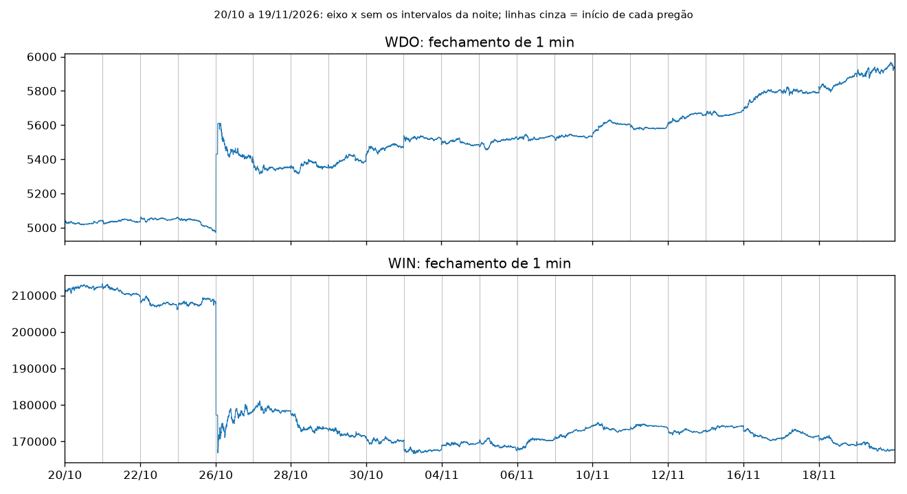

# ISLP aplicado a WDO e WIN (B3)

Estudo do curso **Statistical Learning with Python** (Stanford Online / edX, Hastie & Tibshirani), aplicando cada capítulo a dados **negócio a negócio** dos minicontratos futuros da B3:

- **WDO**: mini dólar
- **WIN**: mini Ibovespa

A ideia não é só refazer os labs do livro. Em cada capítulo, levo o método para dados reais de mercado e procuro dinâmicas nesses dois ativos, que são muito líquidos.

- Livro: *An Introduction to Statistical Learning with Applications in Python* (James, Witten, Hastie, Tibshirani, Taylor, 2023). PDF gratuito em [statlearning.com](https://www.statlearning.com/).
- Curso: [edX — Statistical Learning with Python](https://learning.edx.org/course/course-v1:StanfordOnline+SOHS-YSTATSLEARNINGP+1T2024/home)
- Glossário: [GLOSSARIO.md](GLOSSARIO.md), com os conceitos de mercado, microestrutura e estatística usados no estudo.

## Principais resultados

Amostra de 22 pregões, de 20/10 a 19/11/2026. Premissas, limitações e números completos estão em cada relatório.

- **A direção do próximo minuto não é previsível com estes dados.** Nem o fluxo de agressão, nem os retornos passados, nem o outro ativo: nenhum dos 18 testes de antecipação sobrevive à correção para testes múltiplos, e os modelos dos capítulos 2 e 3 ficam com R² fora da amostra entre −0,4% e +0,1%, ou seja, empatam com prever a média ([exploração](relatorios/00_exploracao_wdo_win.md), [cap. 2](relatorios/ch02_statistical_learning.md), [cap. 3](relatorios/ch03_linear_regression.md)).
- **A intensidade do próximo minuto é previsível, e o efeito é medido com precisão.** Cada bp de \|retorno\| num minuto acrescenta cerca de 0,3 bp ao seguinte, com estatística t de 13 a 14 mesmo com erros-padrão robustos. Com horário e defasagens, o R² fora da amostra chega a 13% no WDO e de 22% a 24% no WIN ([cap. 3](relatorios/ch03_linear_regression.md), [cap. 2](relatorios/ch02_statistical_learning.md)).
- **Uma regressão linear bem especificada compete com o KNN.** Ela vence no WDO e fica de 2 a 3 pontos atrás no WIN, conforme a especificação, contra um KNN com o K escolhido olhando o teste ([cap. 3](relatorios/ch03_linear_regression.md)).
- **O volume é concentrado em poucos negócios e poucas corretoras.** Os 1% maiores negócios carregam 24% do volume do WDO; as 5 maiores corretoras fazem 69% do volume do WDO e 84% do WIN. Os maiores negócios têm as características de ofertas diretas ([exploração](relatorios/00_exploracao_wdo_win.md)).
- **Caudas gordas e poucos eventos dominantes.** A curtose dos retornos de 1 minuto é 15 (WDO) e 21 (WIN), e um único pregão (26/10) concentra a maioria dos minutos mais influentes nas regressões; por isso as análises aparecem com e sem esse dia ([exploração](relatorios/00_exploracao_wdo_win.md), [cap. 3](relatorios/ch03_linear_regression.md)).
- **Com um mês de dados, parte dos resultados ainda muda com a amostra.** Dois pregões a mais mudaram o ranking dos modelos do cap. 2 e o único teste de antecipação abaixo de 0,05 ([cap. 2](relatorios/ch02_statistical_learning.md), [exploração](relatorios/00_exploracao_wdo_win.md)).

## Progresso

| Cap. | Tema | Aplicação em WDO/WIN | Status |
|---|---|---|---|
| 2 | Statistical Learning | Exploração dos dados: volume intradiário, caudas, autocorrelação, fluxo × retorno | ✅ aulas (19/11/2026); exploração no [notebook 00](notebooks/00_exploracao_wdo_win.ipynb); f(X), viés-variância, dimensionalidade e Bayes no [notebook do cap. 2](notebooks/ch02_statistical_learning.ipynb) |
| 3 | Regressão linear | Intensidade e direção do próximo minuto: testes t e F, intervalos, dummies de horário, interações, diagnósticos e erros robustos | ✅ aulas (22/11/2026); inferência e diagnósticos no [notebook do cap. 3](notebooks/ch03_linear_regression.ipynb) |
| 4 | Classificação | Direção do próximo movimento: logística, LDA/QDA, Naive Bayes, KNN contra um baseline ingênuo | ⬜ |
| 5 | Reamostragem | k-fold × *walk-forward*: medir o vazamento de informação do futuro; bootstrap de métricas | ⬜ |
| 6 | Regularização | Ridge/Lasso com dezenas de features (lags, fluxo, horário, WIN→WDO) | ⬜ |
| 7 | Não linearidade | Splines/GAM: efeito do horário do dia e efeito não linear do fluxo | ⬜ |
| 8 | Árvores | Random Forest e Boosting; importância de variáveis | ⬜ |
| 9 | SVM | Classificação de direção com kernels | ⬜ |
| 10 | Deep Learning | MLP/RNN em sequências de barras (PyTorch, CPU) | ⬜ |
| 11 | Sobrevivência | Tempo até o preço andar ±N ticks (*time-to-event*, com censura no fim do pregão) | ⬜ |
| 12 | Não supervisionado | PCA das features; clusters de "tipos de dia" | ⬜ |
| 13 | Testes múltiplos | Testar muitos sinais e ver quantos sobrevivem a FDR/Bonferroni | ⬜ |

## Amostra atual

22 pregões, de 20/10/2026 a 19/11/2026, com o vencimento principal de WDO e WIN em barras de 1 minuto. Detalhes no [notebook 00](notebooks/00_exploracao_wdo_win.ipynb).



O salto em 26/10 é real: de sexta para segunda, o WDO abriu **+9,2%** e o WIN **−14,9%**. É um dia atípico, que altera vários resultados, e por isso as análises são feitas com e sem ele.

## Relatórios

Cada estudo tem uma nota com as perguntas respondidas, as premissas, os achados e um apêndice técnico. O notebook correspondente traz o código e o detalhamento.

| Estudo | Relatório | Notebook |
|---|---|---|
| Exploração dos dados de WDO e WIN | [relatorios/00_exploracao_wdo_win.md](relatorios/00_exploracao_wdo_win.md) | [notebook 00](notebooks/00_exploracao_wdo_win.ipynb) |
| Cap. 2: Statistical Learning | [relatorios/ch02_statistical_learning.md](relatorios/ch02_statistical_learning.md) | [notebook do cap. 2](notebooks/ch02_statistical_learning.ipynb) |
| Cap. 3: Regressão linear | [relatorios/ch03_linear_regression.md](relatorios/ch03_linear_regression.md) | [notebook do cap. 3](notebooks/ch03_linear_regression.ipynb) |

## Dados

**Fonte:** B3, [Boletim Diário do Mercado](https://www.b3.com.br/pt_br/market-data-e-indices/servicos-de-dados/market-data/consultas/boletim-diario/boletim-diario-do-mercado/) → *Derivativos → Derivativos de bolsa → Negócio a negócio*.

**Endereço de download:** a página do Boletim é só uma moldura. O conteúdo vem do aplicativo `arquivos.b3.com.br/bdi`, e o botão "Negócio a negócio → Derivativos" desse aplicativo baixa de `https://drp.b3.com.br/rapinegocios/tickercsv/AAAA-MM-DD?type=1` (`type=1` = derivativos, `type=2` = renda variável). Isso está no código público do aplicativo: `config.js` define `tickerApi` e a função `GetStorageUrl2` monta a URL, conferido em 20/11/2026. O script usa a mesma URL, então os arquivos são os mesmos do download manual.

**Como obter:** `python -m src.b3_download --dias 30` baixa os pregões que ainda não estão em `data/raw/`. Ele faz uma requisição por pregão, com pausa entre elas, e grava os `.zip` sem descompactar. Também dá para baixar manualmente pelo site e salvar na mesma pasta. A B3 só mantém os pregões mais recentes: em 18/11/2026, o dia 19/10 já não estava disponível. Por isso vale rodar o download com frequência para acumular histórico. Os dados **não são versionados** (`data/` está no `.gitignore`), por tamanho e pelos termos de uso da B3.

**Layout** (Glossário B3 *Negócios Listados*, separador `;`, decimal `,`):

| Coluna | Significado |
|---|---|
| `DataReferencia` / `DataNegocio` | data (AAAA-MM-DD) |
| `CodigoInstrumento` | ticker (ex.: `WDOZ26`, `WINZ26`) |
| `AcaoAtualizacao` | 0 = negócio, 2 = cancelado (removido no carregamento) |
| `PrecoNegocio`, `QuantidadeNegociada` | preço e quantidade |
| `HoraFechamento` | HHMMSSmmm, horário de Brasília |
| `CodigoIdentificadorNegocio` | id do negócio |
| `TipoSessaoPregao` | 1 = regular, 6 = after hours |
| `CodigoParticipanteComprador` / `Vendedor` | código numérico da corretora de cada lado (os nomes vêm da [busca de participantes da B3](https://www.b3.com.br/pt_br/produtos-e-servicos/participantes/busca-de-participantes/participantes/); ver `src/corretoras.py`) |
| `TipoDoCanal` | existe no arquivo real, mas não aparece no glossário |

**O que o arquivo real mostra** (pregão de 17/11/2026, `17-11-2026_NEGOCIOSAVISTA_DRV.txt`):
- Tamanho: 50 MB zipado, 520 MB de texto, 7,2 milhões de negócios. Só o WIN tem 5,9 milhões e o WDO 0,8 milhão. O loader lê em blocos e guarda apenas WDO/WIN, ocupando cerca de 300 MB por pregão em memória.
- **Cancelamento:** o negócio original (`AcaoAtualizacao = 0`) continua no arquivo, e o cancelamento entra como uma linha nova (`= 2`) com o mesmo instrumento e id. O loader remove as duas.
- **Ids:** `CodigoIdentificadorNegocio` só é único *dentro* de cada instrumento. WDO e WIN repetem ids.
- **Datas:** algumas centenas de linhas têm `DataNegocio` diferente do pregão (por exemplo, 01h do dia anterior) e são descartadas.
- **Mesmo milissegundo:** cerca de 3/4 dos negócios dividem o milissegundo com outro (75% no WIN e 78% no WDO). A ordem do arquivo é preservada com uma ordenação estável.

- **Negócios diretos:** o arquivo também não marca os negócios diretos (a corretora casa dois clientes dela, sem agressor). As barras trazem duas versões do fluxo: `imbalance`, com todos os negócios, e `imbalance_sem_diretos`, sem os prováveis diretos (proxy baseada nas regras da B3; ver `direct_trade_proxy` em `src/features.py` e o [glossário](GLOSSARIO.md#negócio-direto-oferta-direta)).

> ⚠️ O arquivo **não informa o lado agressor**. O fluxo de compra e venda é *estimado* pela *tick rule* (Lee & Ready, 1991): se o preço sobe em relação ao negócio anterior, conta como compra agressora. Isso é uma aproximação e vale lembrar disso ao interpretar os resultados.

## Estrutura

```
src/
  b3_download.py # baixa os .zip de negócio a negócio para data/raw/
  b3_loader.py   # lê um .zip, filtra WDO/WIN, remove cancelados, monta timestamps
  features.py    # vencimento principal, tick rule, leilões, proxy de negócios diretos, barras, defasagens, retornos futuros
  corretoras.py  # código da corretora -> nome curto (lista oficial de participantes da B3)
  dataset.py     # features, alvos e divisão treino/teste dos capítulos 2 e 3
  pipeline.py    # processa um pregão por vez: data/raw/*.zip -> data/processed/*.parquet
  manifesto.py   # lista dos pregões usados, com o SHA-256 de cada arquivo da B3
  executar.py    # refaz tudo: testes, pipeline, comparação com o manifesto e notebooks
tests/           # testes do código de src/ com dados sintéticos (pytest)
relatorios/      # uma nota de pesquisa por estudo (.md)
  dados_usados.csv  # manifesto: os pregões e hashes que geraram os números das notas
notebooks/
  00_exploracao_wdo_win.ipynb
  ch02_statistical_learning.ipynb
  ch03_linear_regression.ipynb
  chXX_*.ipynb   # um por capítulo do curso
data/            # (não versionado) raw/ = .zip da B3, processed/ = parquet
```

## Como rodar

```bash
python -m venv .venv
.venv\Scripts\activate          # Windows
pip install -r requirements.txt
pip install torch --index-url https://download.pytorch.org/whl/cpu   # só para o cap. 10
```

Depois:

```bash
python -m src.b3_download --dias 30   # ~55 MB por pregão
python -m src.pipeline                # ~1 min por pregão; só processa os dias novos
python -m src.pipeline --refazer      # reprocessa tudo (quando o cálculo das barras mudar)
```

e abra `notebooks/00_exploracao_wdo_win.ipynb`. Os notebooks leem os Parquet de `data/processed/`. Um pregão de WDO+WIN tem cerca de 6,7 milhões de negócios, e processar um dia por vez mantém a memória sob controle.

**Testes e reprodução completa:**

```bash
python -m pytest                              # testes de src/ (~2 s; não precisam dos dados da B3)
python -m src.executar                        # testes + pipeline + comparação com o manifesto + os 3 notebooks (~25 min)
python -m src.executar --atualizar-manifesto  # depois de revisar os textos, registra a amostra nova
```

`relatorios/dados_usados.csv` lista os pregões que geraram os números das notas, com o SHA-256 de cada arquivo da B3: quem tiver os mesmos arquivos obtém os mesmos resultados. O `executar` avisa quando os arquivos de `data/raw/` diferem do manifesto, porque nesse caso os notebooks são refeitos com dados novos, mas os textos ainda citam a amostra anterior.

## Cuidados metodológicos

- **Sem k-fold aleatório em série temporal.** A validação é sempre *walk-forward*: treino no passado, teste no futuro.
- **Retornos não atravessam a noite.** Alvos e defasagens são calculados dentro de cada pregão.
- **Viés de mineração de dados (cap. 13).** Testar muitos sinais e reportar só o melhor gera falsos positivos. Todos os testes ficam registrados.
- **Custos.** Um sinal estatisticamente significativo pode não sobreviver ao *spread* e aos emolumentos. Na hora de avaliar, a comparação é sempre contra 1 tick de custo.
