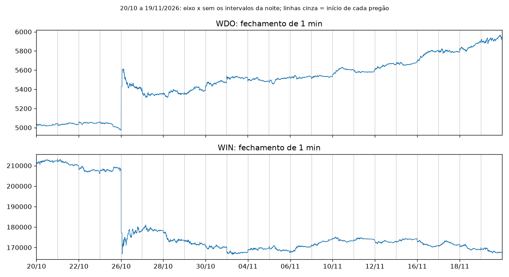
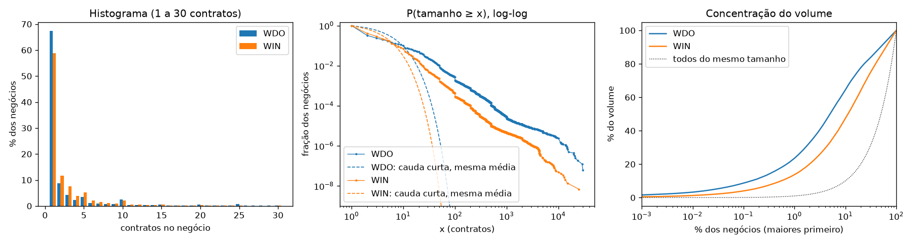
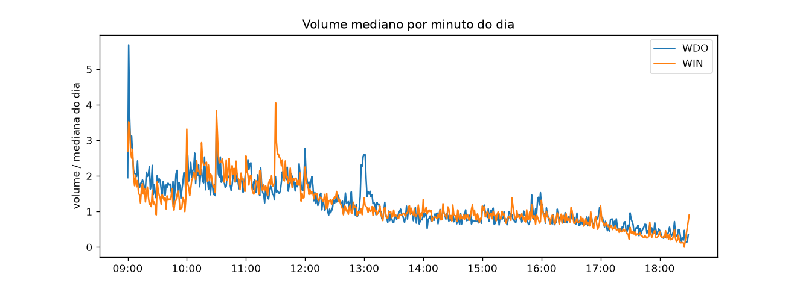

# Exploração dos dados negócio a negócio de WDO e WIN

**Amostra:** 22 pregões, de 20/10 a 19/11/2026, com o vencimento principal do mini dólar (WDO) e do mini Ibovespa (WIN), negócio a negócio e em barras de 1 minuto. **Versão:** 20/11/2026. **Detalhamento e código:** [notebook 00](../notebooks/00_exploracao_wdo_win.ipynb). **Dados:** pregões e hashes em [dados_usados.csv](dados_usados.csv). **Conceitos:** [glossário](../GLOSSARIO.md).

---

## Perguntas respondidas

**1. O fluxo de agressão de um minuto prevê o preço do minuto seguinte?**
Não. O coeficiente do desequilíbrio de agressão sobre o retorno do minuto seguinte tem p-valor de 0,71 no WDO e 0,11 no WIN, com e sem os negócios diretos. Nenhum dos 18 testes de previsão de 1 a 15 minutos sobrevive à correção para testes múltiplos ([A7](#a7-fluxo-de-agressão-e-preço) e [A8](#a8-wdo--win)).

**2. A intensidade do movimento é previsível de um minuto para o outro?**
Sim, a intensidade sim; a direção não. A autocorrelação do |retorno| de 1 minuto é 0,29 no WDO e 0,33 no WIN, enquanto a do retorno com sinal fica perto de zero ([A6](#a6-autocorrelação)).

**3. O volume vem principalmente dos negócios pequenos?**
Não. A maioria dos negócios é de 1 contrato (67% no WDO e 59% no WIN), mas eles movimentam só 16% e 19% do volume. Os 1% maiores negócios carregam 24% do volume do WDO e 14% do WIN ([A1](#a1-tamanho-dos-negócios)).

---

## Premissas

1. **Só o vencimento principal de cada dia.** Em cada pregão, fica apenas o contrato mais negociado de WDO e de WIN. A escolha usa o volume do dia inteiro, que às 9h ainda não seria conhecido. *Verificado:* a troca de vencimento é nítida (na rolagem do WDO em 30/10, 3,4 milhões de contratos no novo vencimento contra 0,2 milhão no anterior).
2. **O lado agressor é estimado, não observado.** O arquivo público da B3 não informa quem agrediu. O lado de cada negócio vem da *tick rule*: alta de preço em relação ao negócio anterior conta como compra agressora, queda como venda. *Não testável com estes dados.* Num estudo com dados da Nasdaq em que o agressor é conhecido, a regra acertou cerca de 78% dos negócios (Ellis, Michaely e O'Hara, 2000).
3. **Os negócios diretos são identificados por uma proxy.** O arquivo não marca os negócios diretos (a corretora casa dois clientes dela, sem agressor). São considerados diretos os negócios com a mesma corretora dos dois lados, pelo menos 500 contratos e fora de leilão, critérios tirados das regras da B3 para oferta direta. *Testado:* as conclusões sobre fluxo e preço são as mesmas com e sem eles.
4. **Retornos não atravessam a noite nem pausas.** São log-retornos de 1 minuto calculados dentro de cada trecho contínuo de negociação. Um trecho novo começa a cada pregão e depois de qualquer intervalo sem negócios maior que 5 minutos (leilões e interrupções).
5. **O dia 26/10 fica na amostra.** É o pregão seguinte ao 2º turno da eleição presidencial, com abertura de +9,2% no WDO e −14,9% no WIN. *Testado:* caudas e autocorrelação são mostradas com e sem esse dia.
6. **Erros-padrão robustos.** Todas as regressões usam erros-padrão HAC (Newey-West), que levam em conta a variância que muda no tempo e a correlação entre minutos vizinhos. Com 18 testes, a significância exige o critério de Bonferroni (p-valor abaixo de 0,05/18 ≈ 0,003).
7. **Limpeza do arquivo.** Negócios cancelados (o original e o cancelamento) e linhas com data diferente do pregão são excluídos. Só existe a sessão regular nos dados.
8. **Os resultados descrevem este período.** Um mês de dados, com dois choques fortes (26/10 e 19/11), não sustenta conclusões sobre outros regimes de mercado.



---

## Achados

### A1. Tamanho dos negócios
- **A contagem e o volume contam histórias diferentes.** 67% dos negócios do WDO e 59% dos do WIN são de 1 contrato, mas eles movimentam só 16% e 19% do volume. No WDO, menos de 8% dos negócios (os de 11 contratos ou mais) carregam ~60% dos contratos.
- **O tamanho tem cauda longa.** A fração de negócios com pelo menos x contratos cai quase em linha reta em escala log-log até dezenas de milhares de contratos. Uma distribuição de cauda curta com a mesma média tornaria praticamente impossível um negócio de 100 contratos (5 em 1 trilhão no WDO); nos dados, é 1 em cada 369.
- **O volume é concentrado.** Os 0,1% maiores negócios carregam 9% do volume do WDO e 4% do WIN; os 1% maiores, 24% e 14%.
- **A média descreve mal o negócio típico.** A média é de 4,3 contratos no WDO e 3,1 no WIN; a mediana é 1 nos dois.
- *Limitação:* o tamanho do negócio não é o tamanho da ordem. Uma ordem grande que encontra várias ordens pequenas no livro vira vários negócios pequenos.



### A2. Negócios gigantes e corretoras
- **Os maiores negócios têm as características de oferta direta.** Os 20 maiores (até 30 mil contratos) têm todos a mesma corretora dos dois lados, saíram no preço de mercado (dentro da faixa dos 50 negócios anteriores e dos 50 seguintes) e durante a negociação contínua, fora dos leilões.
- **A coincidência de corretora não é acaso.** Acima de 5.000 contratos, 97% (WDO) e 100% (WIN) dos negócios têm a mesma corretora dos dois lados, contra 16% a 40% nos negócios de até 1.000 contratos.
- **O mercado é concentrado em poucas corretoras.** Há 31 corretoras em cada ativo, mas as 5 maiores fazem 69% do volume do WDO e 84% do WIN. A maior é a XP (25% e 32%), seguida de IDEAL, BTG e GENIAL.
- **A mesma corretora dos dois lados é comum mesmo sem negócio direto.** Na XP, 44% do volume do WDO e 58% do WIN têm a própria XP na outra ponta: com muitos clientes comprando e vendendo, os dois lados de um negócio são frequentemente clientes dela.
- **Os diretos gigantes vêm de corretoras institucionais.** Entre os 10 maiores negócios do WDO, 4 são do J.P. MORGAN, que não está entre as 10 maiores corretoras em volume.
- *Limitação:* o arquivo identifica a corretora, não o cliente nem o tipo de cliente. A identificação dos diretos é estatística, válida para o grupo e não para cada negócio.

### A3. Leilões
- **O WIN tem um leilão de fechamento diário.** A negociação contínua termina às 18:24:59 (em 28/10, às 18:25:00). Às 18:31, o leilão executa de uma vez de 800 a 3.100 negócios (8 a 31 mil contratos), num único preço e em no máximo 6 milissegundos.
- **Os leilões explicam a faixa intermediária de tamanho no WIN.** Cerca de 63% dos negócios do WIN entre 1.001 e 5.000 contratos saem dos leilões de abertura (44%) e de fechamento (20%). Os negócios acima de 5.000 contratos não saem de leilão.
- *Efeito nas análises:* o leilão de fechamento fica num trecho próprio e não gera retorno de 1 minuto. Ele só entra nas contas de volume.

### A4. Volume ao longo do dia
- **Não há formato de "U".** O volume se concentra na manhã: no WDO, o pico é a abertura (das 9h às 9h30, o minuto médio tem 76% a mais de volume que o minuto médio do dia); no WIN, a maior intensidade fica entre 10h e 12h (70% acima). Das 17h30 ao fechamento, o minuto tem só 40% (WDO) e 27% (WIN) do volume médio.
- **Volume e volatilidade andam juntos.** A correlação entre o perfil de volume e o de |retorno| ao longo do dia é 0,71 no WDO e 0,82 no WIN. O |retorno| típico de 1 minuto é de 2,7 bps (WDO) e 3,4 bps (WIN) na primeira meia hora, contra 1,7 e 2,2 bps entre 14h e 16h.
- *Limitação:* andar junto não é causalidade. Volume e volatilidade podem estar reagindo às mesmas notícias e ao mesmo fluxo de ordens.



### A5. Distribuição dos retornos
- **Caudas gordas.** A curtose dos retornos de 1 minuto é 14,7 no WDO e 20,8 no WIN, contra 3 de uma distribuição normal.
- **Poucos minutos dominam esses números.** No WDO, o maior movimento de 1 minuto foi em 19/11 às 12:03: −47 bps, com 14 vezes o volume do minuto típico do dia, seguido de −30 bps no minuto seguinte. No WIN, os maiores passam de 70 bps (−78 bps em 23/10 e +73 bps em 26/10). Sem 26/10, a curtose do WIN cai para 15,4, enquanto a do WDO sobe para 15,1, porque o choque de 19/11 passa a pesar mais. A assimetria do WIN vai de −0,11 para −0,71.
- *Limitação:* com um mês de dados, curtose e assimetria de 1 minuto descrevem os poucos eventos extremos do período, não um parâmetro estável.

### A6. Autocorrelação
- **A direção quase não tem memória.** A autocorrelação do retorno no lag 1 é −0,02 (WDO) e +0,01 (WIN). Sem 26/10, o WDO mostra uma reversão pequena (o minuto seguinte devolve em média 3% do movimento), mas ela não é significativa com erros HAC (p-valor 0,06) e equivale a menos de 0,1 bp num minuto típico (o |retorno| típico do WDO fica entre 1,7 e 2,7 bps), contra ~0,9 bp de 1 tick.
- **A intensidade tem memória.** A autocorrelação do |retorno| no lag 1 é 0,29 (WDO) e 0,33 (WIN) com todos os pregões, e ~0,22 sem 26/10. É a aglomeração de volatilidade: minuto agitado tende a vir seguido de minuto agitado.
- **A banda usual do gráfico de autocorrelação exagera a significância.** Ela supõe variância constante. A mesma reversão do WDO tem p-valor 0,001 com o erro-padrão comum e 0,06 com o HAC.

### A7. Fluxo de agressão e preço
- **No mesmo minuto, a relação é forte, mas mecânica.** O desequilíbrio de agressão explica 25% (WDO) e 40% (WIN) da variância do retorno do mesmo minuto. Como a tick rule usa o próprio preço para definir o lado, essa relação é quase automática.
- **No minuto seguinte, não há poder preditivo.** p-valor de 0,71 no WDO e 0,11 no WIN.
- **Os negócios diretos distorcem o fluxo em minutos isolados, sem mudar a conclusão.** A proxy marca 843 negócios no WDO (2,3% do volume) e 340 no WIN (0,2%). Num minuto de 09/11, um único negócio direto de 30 mil contratos leva o desequilíbrio de −0,07 para −0,85. Sem os diretos, os p-valores do minuto seguinte ficam entre 0,14 e 0,89.

### A8. WDO × WIN
- **Dólar e bolsa andam em sentidos opostos.** A correlação dos retornos de 1 minuto é −0,46 no período e negativa em todos os 22 pregões, de −0,30 (22/10) a −0,61 (03/11).
- **Nenhum antecipa o outro.** Foram registrados todos os 18 testes feitos (2 ativos × 3 horizontes de 1, 5 e 15 minutos × 3 preditores: fluxo, retorno do próprio ativo e retorno do outro). Só um tem p-valor abaixo de 0,05 (fluxo do WIN prevendo os 5 minutos seguintes, p-valor 0,046), e com 18 testes o acaso produz em média 0,9 resultado assim. Ele não passa no critério de Bonferroni (0,003).
- **O falso positivo muda de lugar quando a amostra cresce.** Com 20 pregões, o teste abaixo de 0,05 era outro (WDO antecipando o WIN em 1 minuto). Com 2 pregões a mais, ele deixou de ser significativo e o atual apareceu.

---

## Apêndice técnico

**Fonte dos dados.** B3, Boletim Diário do Mercado → Derivativos → Negócio a negócio (`https://drp.b3.com.br/rapinegocios/tickercsv/AAAA-MM-DD?type=1`, a mesma URL usada pelo botão de download da página). Um arquivo por pregão, ~50 MB zipado, ~7 milhões de negócios de todos os derivativos. No período: 16,2 milhões de negócios de WDO e 144,7 milhões de WIN no vencimento principal. Os nomes das corretoras vêm da [busca de participantes da B3](https://www.b3.com.br/pt_br/produtos-e-servicos/participantes/busca-de-participantes/participantes/).

**Código (`src/`).**

| Módulo | Função | O que faz |
|---|---|---|
| `b3_loader.py` | `read_trades` | Lê o arquivo em blocos de 500 mil linhas, mantém WDO/WIN, remove cancelamentos (original e cancelamento), descarta datas fora do pregão, ordena de forma estável (preserva a ordem do arquivo no mesmo milissegundo) e guarda texto como `category` (~1,7 GB → ~300 MB por pregão) |
| `features.py` | `front_month` | Vencimento principal por dia (volume do dia) |
| | `tick_rule` | Lado agressor estimado, por pregão |
| | `trading_segments` | Trechos contínuos (novo trecho a cada pregão e após pausas > 5 min) |
| | `auction_mask`, `direct_trade_proxy` | Negócios nos primeiros 50 ms de cada trecho (leilões); proxy de negócios diretos |
| | `time_bars` | Barras de 1 minuto: OHLC, volume, VWAP, `imbalance` e `imbalance_sem_diretos`, log-retorno |
| | `add_lags`, `add_forward_return` | Defasagens e retornos futuros sem atravessar trechos |
| `corretoras.py` | `nome_corretora` | Código da corretora → nome curto |
| `pipeline.py` | `build`, `load` | Processa um pregão por vez para Parquet (`--refazer` reprocessa tudo) e lê as saídas |

**Métodos estatísticos.** OLS com erros-padrão HAC de Newey-West (`statsmodels`, `maxlags` = 5 para 1 minuto e horizonte + 5 para retornos sobrepostos de 5 e 15 minutos); autocorrelação com `missing="conservative"`, para não emendar um pregão no seguinte; correção de Bonferroni para os 18 testes.

**Bibliotecas.** pandas 2.3.3, numpy 2.5.5, statsmodels 0.15.0, matplotlib 3.11.2 e pyarrow 26.0.1 (versões fixadas em `requirements.txt`), além do scipy, instalado como dependência do statsmodels.

**Verificações feitas.**
- Barras recalculadas a partir dos negócios gravados são idênticas às do pipeline.
- Só há a sessão regular nos dados; a rolagem do WDO é nítida.
- A execução dos leilões dura no máximo ~20 ms (WDO) e ~6 ms (WIN), dentro da janela de 50 ms.
- Os negócios diretos alteram o lado estimado de apenas 104 negócios do WDO (0,0006%) e 28 do WIN.
- O teste de "preço dentro da faixa vizinha" exclui o próprio negócio da faixa.

**Reprodução.**
```bash
python -m src.executar   # testes, pipeline, comparação com o manifesto e os notebooks
```
