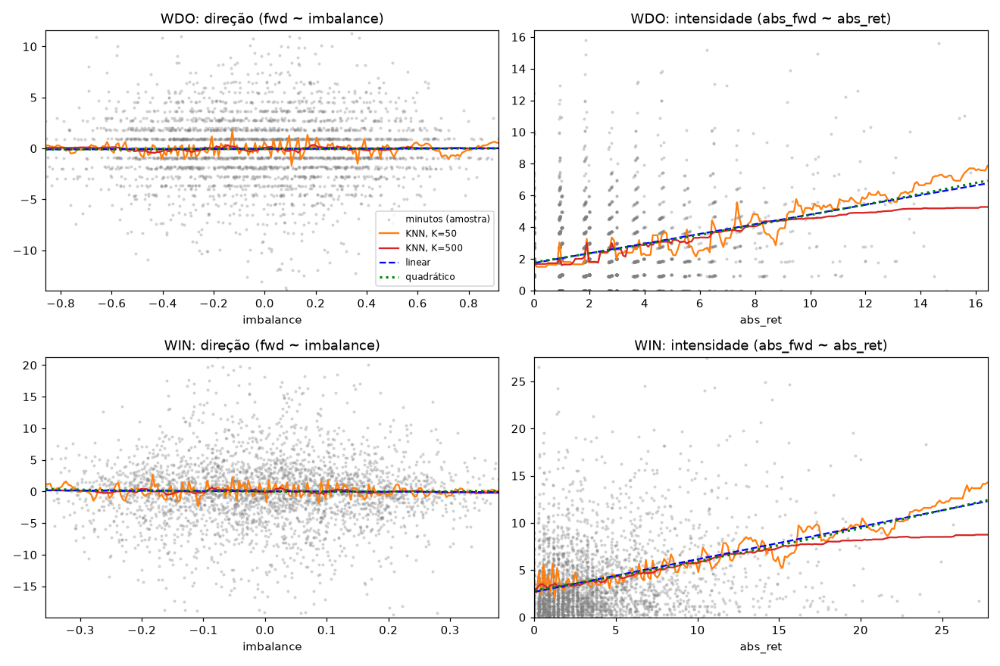
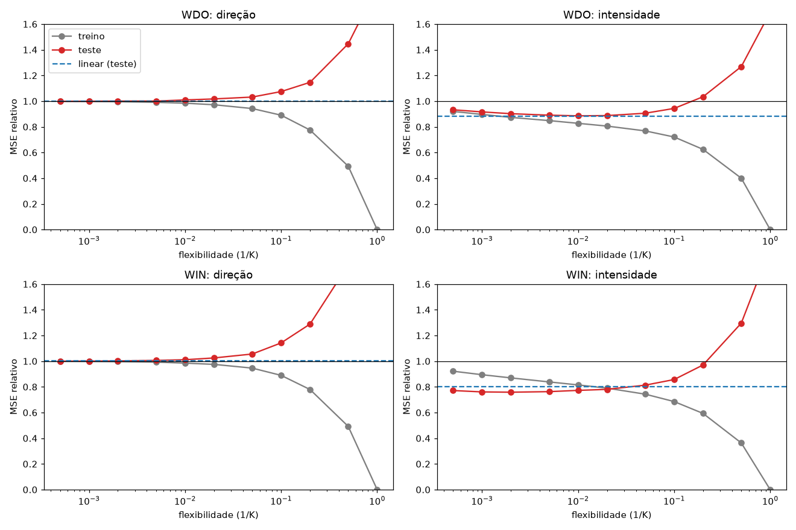
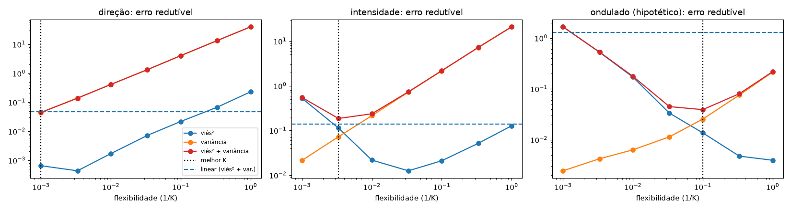

# Cap. 2: Statistical Learning aplicado a WDO e WIN

**Amostra:** 22 pregões, de 20/10 a 19/11/2026, barras de 1 minuto do vencimento principal de WDO e WIN. Treino de 20/10 a 10/11 (15 pregões) e teste de 11/11 a 19/11 (7 pregões). **Versão:** 22/11/2026. **Detalhamento e código:** [notebook do cap. 2](../notebooks/ch02_statistical_learning.ipynb). **Dados:** pregões e hashes em [dados_usados.csv](dados_usados.csv). **Conceitos:** [glossário](../GLOSSARIO.md#aprendizado-estatístico-islp-cap-2).

---

## Perguntas respondidas

**1. A direção do próximo minuto é previsível com estas features?**
Não. O melhor modelo de regressão tem R² fora da amostra de 0,10% (WDO) e 0,05% (WIN), e o classificador KNN não bate de forma confiável o chute de prever sempre a classe mais comum ([A1](#a1-fx-e-erro-irredutível), [A3](#a3-flexibilidade-e-erro-de-teste) e [A5](#a5-classificação)).

**2. Um modelo mais flexível prevê melhor a intensidade do próximo minuto?**
Não necessariamente. No WDO, a regressão linear empata com o melhor KNN (11,5% contra 11,4% de R² fora da amostra). No WIN, o KNN fica à frente (24,2% contra 20,0%), mas com o K escolhido olhando o próprio teste ([A3](#a3-flexibilidade-e-erro-de-teste) e [A7](#a7-interpretabilidade-e-estabilidade)).

**3. Acrescentar features ajuda o KNN?**
Não. Com 9 features, a vizinhança que contém 10% dos minutos já cobre ~60% da distância típica entre dois minutos, e 50 features de ruído tiram ~40% do R² do KNN, contra quase nada da regressão linear ([A2](#a2-dimensionalidade)).

---

## Premissas

1. **Os mesmos dados nos capítulos 2 e 3.** Barras de 1 minuto do vencimento principal, com 9 features conhecidas no fechamento do minuto (retornos e \|retornos\| atuais e defasados, desequilíbrio de agressão, volume e horário) e dois alvos do minuto seguinte: a **direção** (retorno) e a **intensidade** (\|retorno\|), em bps. Defasagens e alvos não atravessam a noite nem pausas. A preparação está em `src/dataset.py`.
2. **Treino e teste são separados por data, nunca por sorteio.** Os primeiros 70% dos pregões vão para o treino. Sortear minutos colocaria o futuro no treino.
3. **Nada do teste entra no ajuste.** A padronização das features e o limiar de "minuto agitado" (a mediana do treino) são calculados só no treino.
4. **A medida de erro é relativa a não saber nada.** O MSE de cada modelo é dividido pelo de prever sempre a média do treino; 1 menos essa razão é o R² fora da amostra. Valores negativos indicam um modelo pior que a média.
5. **O K do KNN foi escolhido olhando o teste.** Isso deixa os resultados do KNN otimistas e favorece o KNN nas comparações com a regressão linear.
6. **As simulações usam um f hipotético construído com os dados reais.** Na decomposição viés-variância e no classificador de Bayes, o f "verdadeiro" é uma curva estimada nos dados (linear para a direção, KNN com K=500 para a intensidade), e o ruído são resíduos reais sorteados, independentes de X. Para a intensidade, essa curva achata nos extremos por viés de borda do KNN (A1), então ela é plausível, mas não é o f real.
7. **Uma única divisão treino/teste.** Os resultados dependem de quais pregões caíram no teste. *Testado:* com 20 pregões (treino até 09/11), o ranking dos modelos era outro (A7).

---

## Achados

### A1. f(X) e erro irredutível
- **Na direção, quase todo o erro é irredutível.** A curva estimada do retorno seguinte contra o desequilíbrio de agressão é plana em zero; o R² fora da amostra é ~0 na reta e na parábola e negativo no KNN.
- **Na intensidade, há uma parte redutível.** Só com o \|retorno\| atual, o R² fora da amostra é de 7% a 8% no WDO e ~13% no WIN: minuto agitado tende a ser seguido de minuto agitado.
- **A relação na intensidade é quase linear e não achata nos extremos.** Nas médias por faixa de \|retorno\| atual, os dados acompanham a reta até o 0,1% de minutos mais agitados. O KNN com K=500 achata nessa faixa, porque nas bordas os vizinhos vêm todos de valores menores (**viés de borda**): no WIN, ele prevê 9 bps onde a média real é 24 bps. A parábola ganha pouco da reta (7,9% contra 7,5% no WDO; 13,3% contra 13,0% no WIN), e o KNN perde para a reta no WDO (4,7%).
- *Limitação:* "irredutível" é relativo às features escolhidas. Outra informação, como o livro de ofertas, poderia tornar parte desse erro redutível.



### A2. Dimensionalidade
- **A vizinhança deixa de ser local rapidamente.** O raio que contém 10% dos minutos é de 3% a 13% da distância típica entre dois minutos com 1 feature e passa de 58% (WIN) e 63% (WDO) com 9. Os dados reais sofrem um pouco menos que pontos uniformes num cubo (74% com 9 features), porque as features são correlacionadas.
- **Features inúteis prejudicam o KNN, não a regressão linear.** Com 50 features de ruído, o R² fora da amostra do KNN cai de 4,7% para 2,7% (WDO) e de 13,0% para 8,1% (WIN). O da regressão linear vai de 7,5% para 7,4% e de 13,0% para 11,4%: ela estima um coeficiente perto de zero para o ruído.

### A3. Flexibilidade e erro de teste
- **O erro de treino sempre cai com a flexibilidade** e chega a zero com K=1. Ele não serve para escolher o modelo.
- **Na direção, o melhor é o modelo mais rígido.** O ótimo é K=2.000, com R² fora da amostra de ~0; com K=1, o R² é de −89% (WDO) e −145% (WIN).
- **Na intensidade, aparece o "U".** O ótimo é K=100 (WDO) e K=500 (WIN), com R² fora da amostra de 11% e 24%. A regressão linear com as mesmas 9 features chega a 11,5% (WDO) e 20% (WIN).



### A4. Viés e variância
Decomposição medida por simulação, em bps², com 200 conjuntos de treino de 2.000 minutos (WIN):
- **Sem sinal (direção):** o viés² é minúsculo em qualquer K, e o erro redutível é só variância. O melhor é o mais rígido: KNN com K=1.000 ou a regressão linear, ambos com 40,29, contra um erro irredutível de 40,24.
- **Sinal fraco e muito ruído (intensidade):** o "U" clássico. De K=1.000 para K=30, o viés² cai de 0,53 para 0,013 e a variância sobe de 0,02 para 0,72 (21 com K=1). A regressão linear fica ligeiramente melhor que o melhor KNN (21,22 contra 21,27).
- **Cenário hipotético de f ondulado e pouco ruído:** a flexibilidade compensa. O melhor KNN é o de K=10 (0,25), e a reta erra muito (1,49), quase tudo viés.
- **Nos casos reais, o erro irredutível (40 e 21) é de 100 a 1.000 vezes maior** que viés² + variância no melhor modelo (0,04 e 0,14). O limite do que um modelo pode melhorar é o erro irredutível.



### A5. Classificação
- **Direção (sobe, parado, cai):** no WDO, o KNN erra 55,1%, contra 55,0% do chute ingênuo. No WIN, erra 49,2% contra 51,0%, uma diferença de ~2 erros-padrão (0,8 ponto), obtida com o melhor de 10 valores de K escolhido no teste, o que não é evidência de sinal.
- **Minuto agitado (\|retorno\| acima da mediana do treino):** o KNN erra 36,5% (WDO) e 35,4% (WIN), contra 40,7% e 39,1% de prever sempre "calmo". No WIN, o chute ingênuo da tabela (60,9%) é "sempre agitado", porque as classes empataram no treino e "agitado" ganhou por décimos.
- **O teste foi mais calmo que o treino:** só 39% a 41% dos minutos do teste ficaram acima da mediana de agitação do treino, que inclui 26/10.

### A6. Probabilidades e o classificador de Bayes
- **As probabilidades do KNN ordenam bem e erram o nível.** Da faixa de probabilidade mais baixa à mais alta, a fração de minutos de fato agitados vai de 19% a 74% no WDO e de 21% a 67% no WIN. Mas, nas faixas baixas, o modelo exagera o risco: com probabilidade estimada de 0,32, só 19% dos minutos do WDO foram agitados.
- **O KNN chega perto do mínimo possível.** Numa simulação em que a probabilidade verdadeira é conhecida, o erro de Bayes é de 42,0%, e o melhor KNN chega a 42,3%. A fronteira de decisão de Bayes é um \|retorno\| atual de 3,45 bps.

### A7. Interpretabilidade e estabilidade
- **Uma regressão linear legível perde pouco ou nada.** Com 9 features, ela empata com o KNN no WDO (11,5% contra 11,4%) e fica 4 pontos atrás no WIN (20,0% contra 24,2%). Só com as 3 defasagens de \|retorno\|, ela mantém 18,9% no WIN e 9,4% no WDO. Os coeficientes mostram que o \|retorno\| atual e os anteriores são o que mais importa e que a agitação cai ao longo do dia.
- **O ranking dos modelos muda com a amostra.** Com 20 pregões (treino até 09/11), o melhor KNN batia a reta por 2 pontos no WDO e 5 no WIN, e os R² da intensidade eram de 16% e 30%. Com 2 pregões a mais, a vantagem do KNN sumiu no WDO e os R² caíram para 11% e 24%.

---

## Apêndice técnico

**Dados.** Barras de 1 minuto do pipeline (ver [nota do notebook 00](00_exploracao_wdo_win.md)). `src/dataset.py` concentra a preparação usada nos capítulos 2 e 3: `montar` (features e alvos de um ativo), `carregar` (todos os ativos) e `dividir` (treino e teste por data). No treino, 8.469 minutos de WDO e 8.392 de WIN; no teste, 3.962 e 3.923.

**Modelos e métodos.**

| Seção | Método | Detalhes |
|---|---|---|
| A1 | KNN 1D, regressão linear e quadrática | `KNeighborsRegressor`, `LinearRegression`, `PolynomialFeatures(2)` |
| A2 | Raio da vizinhança de 10% | `NearestNeighbors`, 300 pontos de consulta; ruído N(0, 1) |
| A3 | KNN com K de 1 a 2.000 | `StandardScaler` ajustado no treino + `KNeighborsRegressor` |
| A4 | Decomposição viés-variância | 200 repetições, treino de 2.000 minutos, 300 pontos fixos de avaliação |
| A5, A6 | KNN classificador e calibração | `KNeighborsClassifier`; probabilidade = fração de vizinhos agitados |
| A6 | Classificador de Bayes | probabilidade verdadeira = KNN com K=500; treino de 2.000 e teste de 200.000 rótulos simulados |
| A7 | Coeficientes padronizados | regressão linear sobre features padronizadas |

**Bibliotecas.** scikit-learn 1.9.1, pandas 2.3.3, numpy 2.5.5, matplotlib 3.11.2. Sementes fixas (`numpy.random.default_rng`) em todas as simulações.

**Verificações feitas.**
- Ao mover a preparação dos dados para `src/dataset.py`, todas as saídas do notebook ficaram idênticas às da versão anterior.
- A padronização e o limiar de "agitado" usam só o treino.
- As médias por faixa de \|retorno\| confirmam que o achatamento da curva do KNN nos extremos é viés de borda, não uma característica dos dados.

**Reprodução.**
```bash
python -m src.executar   # testes, pipeline, comparação com o manifesto e os notebooks
```
