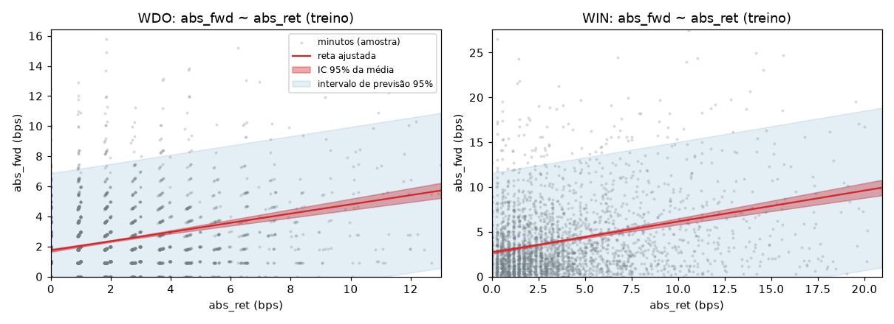
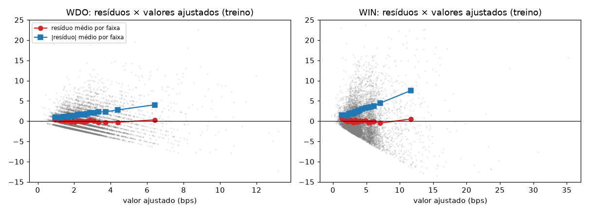

# Cap. 3: Regressão linear aplicada a WDO e WIN

**Amostra:** 22 pregões, de 20/10 a 19/11/2026, barras de 1 minuto do vencimento principal de WDO e WIN. Inferência no treino (20/10 a 10/11, 15 pregões); previsão fora da amostra no teste (11/11 a 19/11, 7 pregões). **Versão:** 22/11/2026. **Detalhamento e código:** [notebook do cap. 3](../notebooks/ch03_linear_regression.ipynb). **Conceitos:** [glossário](../GLOSSARIO.md#regressão-linear-islp-cap-3).

---

## Perguntas respondidas

**1. O \|retorno\| de um minuto tem efeito estatisticamente significativo sobre o \|retorno\| do minuto seguinte?**
Sim. Cada bp de \|retorno\| atual acrescenta, em média, 0,31 bp (WDO) e 0,35 bp (WIN) ao minuto seguinte, com estatística t de 13 a 14 mesmo com erros-padrão robustos. Mas sozinho ele explica só 9% a 12% da variância ([A1](#a1-o-efeito-do-retorno-atual)).

**2. Alguma combinação das 9 features explica a direção do próximo minuto?**
Não. O teste F de todas as features tem p-valor de 0,11 (WDO) e 0,07 (WIN), nenhum coeficiente passa na correção para testes múltiplos e o R² fora da amostra é negativo, com e sem os negócios diretos ([A6](#a6-direção-do-próximo-minuto)).

**3. As premissas clássicas da regressão valem para estes dados?**
Não. Há heterocedasticidade forte, outliers de 5 a 6 vezes a frequência de uma normal e um único pregão (26/10) concentrando 70% a 80% dos minutos mais influentes. A autocorrelação dos erros é a exceção: é desprezível ([A5](#a5-diagnóstico-do-modelo)).

---

## Premissas

1. **Os mesmos dados do cap. 2.** As 9 features e os dois alvos (direção e intensidade do próximo minuto, em bps) vêm de `src/dataset.py`, com a mesma divisão por data.
2. **Toda a inferência usa só o treino.** Coeficientes, testes e escolhas de especificação são feitos nos 15 primeiros pregões. O teste mede a previsão fora da amostra e nunca é usado para escolher o modelo.
3. **Erros-padrão HAC (Newey-West) em todos os testes**, com 5 defasagens. *Testado:* o erro-padrão comum aparece ao lado quando a diferença importa; na regressão simples, o HAC é 2,2 a 2,4 vezes maior.
4. **O horário entra como faixas** (7 faixas, com a primeira meia hora como referência), e o dia 26/10, que está no treino, tem uma *dummy* própria.
5. **O volume é centralizado na média do treino** nos termos de interação, para que os coeficientes sejam lidos num minuto de volume médio.
6. **O KNN da comparação final usa o K escolhido no cap. 2**, que foi escolhido olhando o teste. Isso favorece o KNN.
7. **A intensidade (\|retorno\|) não é transformada**, apesar da heterocedasticidade. O log, sugerido pelo livro, esbarra nos minutos de \|retorno\| zero, frequentes no WDO; a inferência usa erros-padrão robustos.

---

## Achados

### A1. O efeito do \|retorno\| atual
- **O efeito é medido com precisão:** 0,31 bp (WDO) e 0,35 bp (WIN) a mais no \|retorno\| seguinte por bp de \|retorno\| atual. O intervalo de confiança de 95% com erros HAC é de [0,26; 0,35] no WDO e [0,30; 0,39] no WIN.
- **O erro-padrão robusto é mais que o dobro do comum** (no WDO, 0,023 contra 0,010), mas a estatística t continua entre 13 e 14.
- **Significativo não é o mesmo que forte.** O R² é de 9,4% (WDO) e 12,0% (WIN), e o erro típico da reta (RSE) é de 2,6 e 4,5 bps, do tamanho do próprio \|retorno\| típico.
- **O modelo fala da média, não de um minuto.** Num minuto de 5 bps no WDO, a média do minuto seguinte está entre 3,1 e 3,4 bps, mas o intervalo de previsão para um minuto específico vai de −1,9 a 8,4 bps. O limite negativo, impossível para um \|retorno\|, mostra que a premissa de erros normais não vale.



### A2. Regressão múltipla e teste F
- **O conjunto das 9 features explica a intensidade:** F = 90 (WDO) e 106 (WIN), p-valor ≈ 0.
- **As defasagens de \|retorno\| acrescentam informação** além do minuto atual (p-valor ≈ 0); volume e horário, juntos, também.
- **As features de direção não acrescentam nada:** retornos com sinal e desequilíbrio de agressão, juntos, têm p-valor de 0,38 (WDO) e 0,15 (WIN).
- **Com as features juntas, cada coeficiente de \|retorno\| cai à metade ou menos** (no WDO, o atual vai de 0,31 para 0,15), porque sozinho ele carrega o efeito das defasagens e do horário.

### A3. Confusão: o volume do WIN
- **Sozinho, o volume parece importar; com as outras features, não.** No WIN, o coeficiente do log do volume é +1,18 (p-valor ≈ 0) na regressão simples e −0,16 (p-valor 0,21) na múltipla. O volume alto aparece junto com minutos agitados (correlação de 0,36) e com a manhã (−0,58 com o horário) e "empresta" o efeito dessas variáveis. É o exemplo do jornal no livro.
- **Não é colinearidade:** o VIF fica entre 1,0 e 1,7 em todas as features, longe do limite de 5 a 10.
- **No WDO, o volume continua importando** na múltipla (0,29, p-valor ≈ 0), embora bem menos que sozinho (0,89).

### A4. Horário, interações e não linearidade
- **O horário tem formato próprio em cada ativo.** As faixas, juntas, são significativas (F = 10,4 no WDO e 19,2 no WIN). No WDO, a agitação cai a partir das 12h (−0,5 a −0,8 bp em relação à primeira meia hora). No WIN, a faixa das 10h às 12h é mais agitada que a abertura (+1,3 bp), o mesmo formato do volume.
- **O dia 26/10 foi mais agitado do que o \|retorno\| de cada minuto indica:** +2,1 bps no WDO e +4,8 bps no WIN.
- **A interação \|retorno\| × volume tem sinais opostos:** +0,044 no WDO (p-valor 0,009) e −0,106 no WIN (p-valor ≈ 0).
- **No WIN, a relação acelera nos extremos:** o termo quadrático é positivo (p-valor 0,0007). Isso confirma, com outro método, que a curva real não achata (cap. 2). No WDO, o termo não é significativo.
- **Significativo no treino não garante previsão melhor.** O R² fora da amostra do WIN cai de 22,4% para 20,8% quando entra a interação, que tem p-valor ≈ 0 no treino. Já o R² do treino sobe sempre que se acrescenta um termo.

### A5. Diagnóstico do modelo
- **Heterocedasticidade forte:** o tamanho do resíduo cresce com o valor ajustado (correlação de 0,43 no WDO e 0,47 no WIN), e o teste de Breusch-Pagan tem p-valor ≈ 0. É o principal motivo de o erro-padrão robusto sair mais que o dobro do comum.
- **Autocorrelação dos erros desprezível:** Durbin-Watson de 2,0 e autocorrelação de lag 1 de −0,01 nos dois ativos.
- **Sem não linearidade restante:** o resíduo médio fica perto de zero em toda a faixa de valores ajustados.
- **Outliers e influência:** 1,7% (WDO) e 1,4% (WIN) dos minutos têm resíduo estudentizado acima de 3 em valor absoluto, de 5 a 6 vezes o esperado numa normal. Entre os minutos mais influentes (1% do treino), 58 de 84 (WDO) e 66 de 83 (WIN) são de 26/10. Sem eles, o coeficiente linear do \|retorno\| no WIN cai de 0,063 para 0,021, e o R² do treino de 25,4% para 21,4%.



### A6. Direção do próximo minuto
- **O conjunto não explica a direção.** O teste F tem p-valor de 0,11 (WDO) e 0,07 (WIN); sem os negócios diretos, 0,08 nos dois.
- **Fora da amostra, o modelo é pior que prever a média:** R² de −0,2% (WDO) e −0,4% (WIN).
- **Alguns coeficientes isolados têm p-valor abaixo de 0,05**, mas nenhum passa no critério de Bonferroni (0,05/9 ≈ 0,0056). Com 9 coeficientes por modelo, o acaso produz em média 0,45 resultado assim.

### A7. Regressão linear × KNN fora da amostra
- **No WDO, a regressão linear com faixas de horário, interação e termo quadrático vence o KNN:** 13,0% de R² fora da amostra, contra 11,4% do KNN e 11,5% da regressão linear simples com 9 features.
- **No WIN, o KNN fica à frente:** 24,2%, contra 22,4% do melhor modelo linear (faixas de horário e dummy de 26/10), com o K escolhido olhando o teste.
- **O que mais ajudou a regressão linear foram as faixas de horário** (no WIN, de 20,0% para 22,4%). Como a relação com o \|retorno\| é quase linear, o principal desvio da reta era o formato do dia.

---

## Apêndice técnico

**Dados.** `src/dataset.py` (`carregar` e `dividir`), os mesmos do cap. 2. No treino, 8.469 minutos de WDO e 8.392 de WIN. O notebook acrescenta as faixas de horário, a dummy de 26/10 e o volume centralizado.

**Modelos e testes.**

| Seção | Método | Implementação |
|---|---|---|
| A1 | Regressão simples, IC e intervalo de previsão | `statsmodels.formula.api.ols`, `get_prediction().summary_frame()` |
| A2, A3 | Regressão múltipla, teste F global e de grupos | `.fit(cov_type="HAC", cov_kwds={"maxlags": 5})`, `.f_test()` sobre a covariância robusta |
| A4 | Dummies, interação e termo quadrático | fórmulas `C(faixa)`, `abs_ret:log_vol_c`, `I(abs_ret ** 2)` |
| A5 | Diagnóstico | `het_breuschpagan`, `durbin_watson`, `OLSInfluence` (resíduo estudentizado, alavancagem, distância de Cook), `variance_inflation_factor` |
| A7 | Comparação com o KNN | `StandardScaler` + `KNeighborsRegressor` com o K do cap. 2 |

As medidas de influência usam o ajuste com erro-padrão comum, porque dependem só dos coeficientes e dos resíduos, que são os mesmos.

**Bibliotecas.** statsmodels 0.15.0, scikit-learn 1.9.1, pandas 2.3.3, numpy 2.5.5, matplotlib 3.11.2.

**Verificações feitas.**
- A centralização do volume não muda o ajuste: os R² com e sem centralizar são idênticos; mudam só os coeficientes de `abs_ret` e do volume.
- O termo quadrático positivo do WIN não vem de 26/10, o dia de maior alavancagem: no mesmo modelo sem a dummy, ele vai de 0,0030 com todos os pregões do treino para 0,0070 (p-valor < 0,0001) sem esse dia (notebook, seção 4).
- As médias por faixa de \|retorno\| (cap. 2, seção 1) e o termo quadrático apontam na mesma direção: a curva real não achata.

**Reprodução.**
```bash
python -m src.pipeline   # se houver pregões novos em data/raw/
# depois, executar notebooks/ch03_linear_regression.ipynb (~4 minutos)
```
